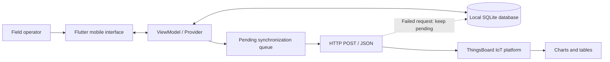

# Offline-First Phenotypic Data Collection for Protected Crops

**An undergraduate Automation Engineering thesis (UCLV, Cuba · July 2025)**  
**Author:** Miguel Garcés Vázquez · **Thesis supervisor:** Dr. Iván Santana Ching

> **Technical and academic project showcase.** This repository documents an application implemented and evaluated as part of an undergraduate thesis. It contains authentic project screenshots and thesis-reported results, but **does not include the Flutter source code or a downloadable APK**.

[Versión en español](README.es.md) · [Architecture](docs/architecture.md) · [Data model](docs/data-model.md) · [Evaluation](docs/validation.md) · [Project background](docs/research-context.md)

## The challenge

Protected-crop farms in **Valle del Yabú, Villa Clara, Cuba** already collect agrometeorological data using sensors. However, recording crop **phenotypic observations** (e.g., stem diameter, flower and fruit counts, fruit weight) manually was irregular and difficult to standardize. Intermittent connectivity made online-only collection unsuitable.

The project addresses the collection and availability of these observations with an **offline-first Android application**, so field workers can save their measurements without internet access and later send them to the **ThingsBoard IoT platform**.

## The solution

- **Three crops:** tomato, cucumber, and bell pepper, each with crop-specific forms.
- **Offline-first records:** create, view, edit, and delete field observations stored locally in SQLite.
- **Data quality:** validate required and typed fields, and associate records with collection dates.
- **Deferred IoT synchronization:** mark pending records locally, submit JSON via HTTP to ThingsBoard, and retry failed submissions.
- **Visualization:** browse/filter local records and use ThingsBoard charts and tables after synchronization.
- **Reminders:** configure local reminders for systematic data collection.
- **Accessible field workflow:** first-use guidance, responsive forms, and a simple, task-oriented interface.

### Actual application screenshots

The following images are **extracted from the original 2025 thesis**, not generated mockups.

| Home | Tomato data collection | Stored observations |
|:--:|:--:|:--:|
|  |  |  |

| IoT synchronization | Reminders |
|:--:|:--:|
|  |  |

More screenshots and their provenance: [screenshots and figures](docs/screenshots.md).

## System architecture

**Flutter/Dart + MVVM + SQLite + HTTP/JSON + ThingsBoard**

Observations remain available on the device when offline. Synchronization transfers pending records when connectivity is available, with retry support for failed transmissions. See [architecture and implementation notes](docs/architecture.md).

## Collected phenotypic variables

The application includes **15 crop–variable combinations** specified in the thesis (Table 3.1):

| Crop | Recorded variables |
| --- | --- |
| **Cucumber** | Stem diameter, flower count, fruit count, fruit weight, fruit length |
| **Tomato** | Stem diameter, flower count, fruit count, fruit weight, fruit firmness (1–10 scale) |
| **Bell pepper** | Stem diameter, flower count, fruit count, fruit weight, lobe count |

Units and validation types: [complete data dictionary](docs/data-model.md) · [CSV](results/phenotypic-variables.csv).

## Measured results (as reported in the thesis)

### Local SQLite benchmark (Table 3.4)

| Test | Workload | Total time |
| --- | ---: | ---: |
| Bulk insertion | 10,000 records | **804 ms** |
| Read/consultation | 1,000 retrieved records | **381 ms** |
| Bulk update | 1,000 records | **522 ms** |
| Database cleanup | 10,000 deleted records | **162 ms** |

### IoT connectivity and compatibility

- A series of **100 sequential HTTP availability requests** to the ThingsBoard server was analyzed in the thesis (Section 3.4.1): **1,069.5 ms** mean response time, **218.4 ms** standard deviation, and **1,027 ms** median. These are *network request measurements*, not proof of 100 successful telemetry writes.
- The comparative results table (Table 3.5) separately reports **1,057 ms** for an individual synchronization operation.
- The application was installed and evaluated on **four Android devices** (Android 11 Go, Android 13, Android 13 Go, and Android 14) and in an Android emulator. The thesis reports successful operation on all four tested phones.

**Interpretation:** the measurements describe the specific test configurations used during the thesis; they are not cross-device or production service-level guarantees. Full details: [validation](docs/validation.md).

## ThingsBoard dashboards

| Phenotypic trends | Structured synchronized records |
|:--:|:--:|
|  |  |

The dashboards present crop measurements over time in charts and timestamped tables (thesis Section 3.2.4).

## Technologies and scope

| Area | Implementation |
| --- | --- |
| Mobile UI | Flutter / Dart |
| Architectural pattern | MVVM, with Provider mentioned in the thesis requirements |
| Offline storage | SQLite (`sqflite`) |
| Networking | HTTP requests, JSON payloads |
| IoT telemetry | ThingsBoard |
| Development and tests | VS Code, Android Studio emulator, physical Android devices |
| Research context | Precision agriculture / field phenotyping |

**Scope boundary:** the work supports **data acquisition for future predictive models**; it does **not** report training a new machine-learning model, implementing automated irrigation control, or deploying the application at production scale.

## Documentation map

| Document | Contents |
| --- | --- |
| [Research context](docs/research-context.md) | Motivation, objectives, research scope |
| [Architecture](docs/architecture.md) | Components and offline-to-cloud flow |
| [Data model](docs/data-model.md) | Crop-specific fields, types, units, SQLite organization |
| [Features](docs/features.md) | Main mobile screens and user flow |
| [Validation](docs/validation.md) | Device matrix, SQLite and connectivity test data |
| [Screenshots](docs/screenshots.md) | Original images and corresponding thesis figures |
| [Academic citation and rights](docs/citation-and-rights.md) | Thesis details, advisor credit, publication scope |
| [Release notes](docs/development-history.md) | Thesis-reported development milestones |
| [Publications / repository setup](GUIA_PUBLICACION.md) | GitHub instructions in Spanish |

## Source code, reproducibility and availability

This repository currently contains **project documentation and visual evidence only**. The source files, build scripts, APK, original test datasets, and ThingsBoard server configuration have **not** been published here. Thus, visitors **cannot rebuild the application from this repository alone**.

The included tables are transcriptions of the original thesis, not freshly executed benchmarks. No unpublished raw field dataset or credentials are included.

## Academic attribution

**Thesis (2025):** *Aplicación móvil para el registro de datos fenotípicos de cultivos protegidos*. Universidad Central “Marta Abreu” de Las Villas, Faculty of Electrical Engineering, Department of Automatic Control, Santa Clara, Cuba. **Author:** Miguel Garcés Vázquez. **Supervisor:** Dr. Iván Santana Ching.

Documentation and images are reproduced from the author's thesis with the author's stated authorization. Publication and reuse remain subject to the University's applicable rights and the thesis license. See [citation and rights](docs/citation-and-rights.md).

**Author's profiles:** [GitHub @Miwe02](https://github.com/Miwe02) · [YouTube engineering demonstrations](https://www.youtube.com/@MiguelGarc%C3%A9sV%C3%A1zquez-k7z)
