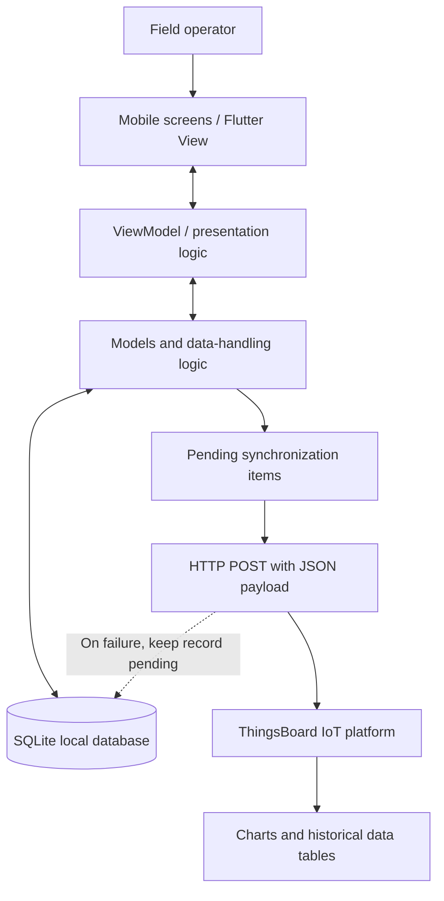
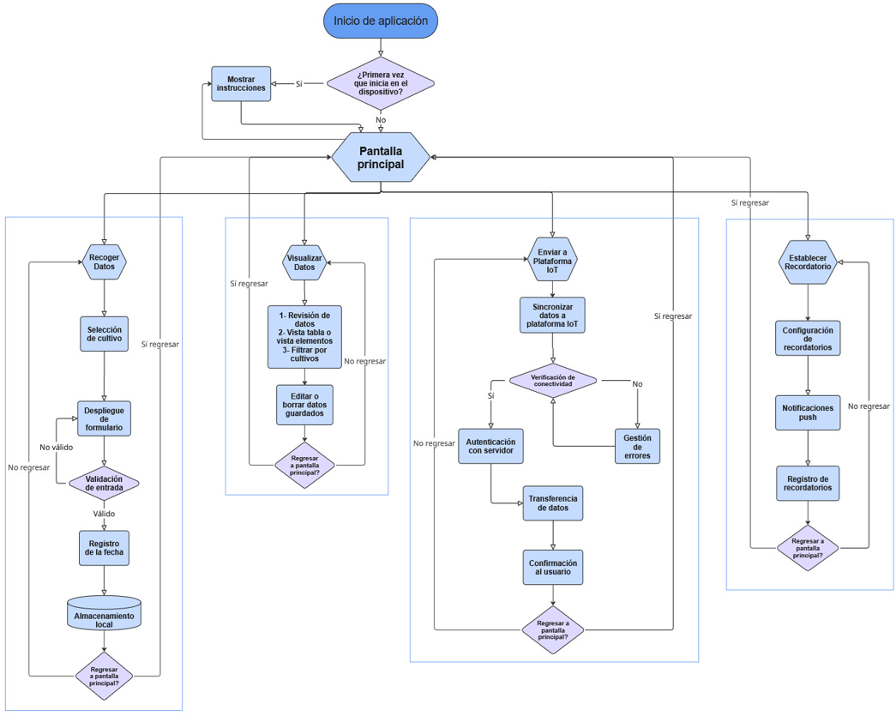
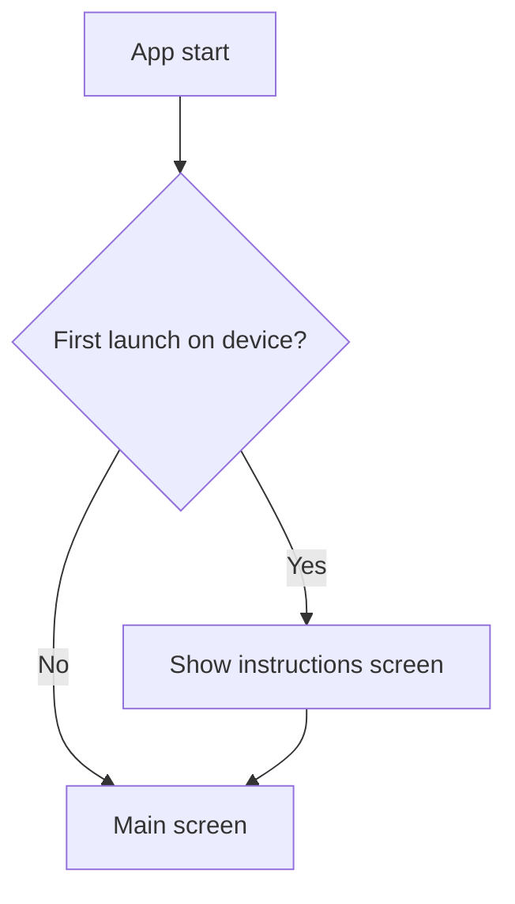
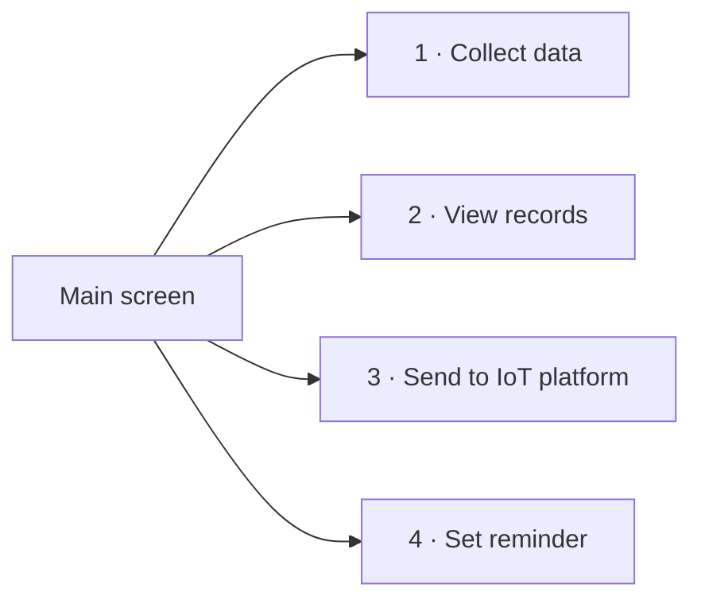
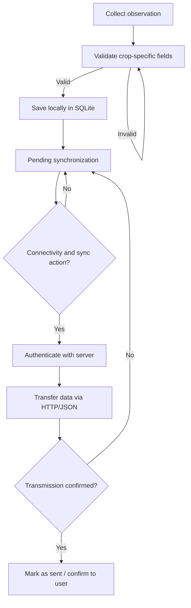
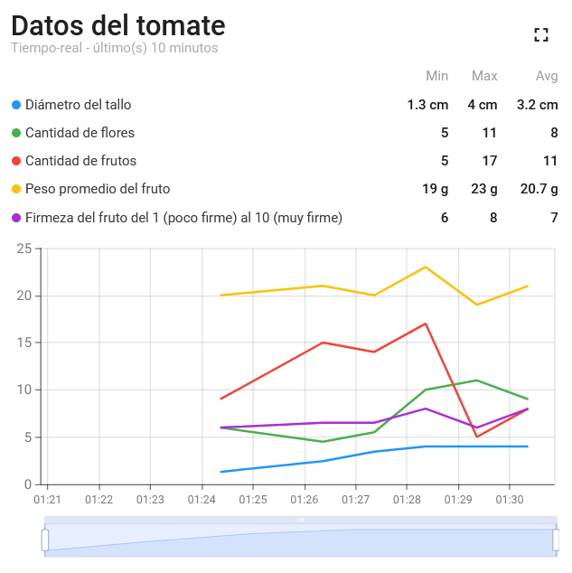
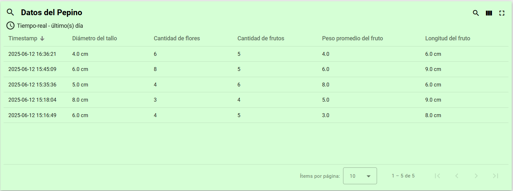

# Software architecture and synchronization

## Components

The implemented application uses Flutter/Dart and the **Model–View–ViewModel (MVVM)** architectural pattern. The thesis also describes **Provider** in the non-functional requirements, a local **SQLite** database for offline records, and **HTTP POST + JSON** as the connection mechanism with the ThingsBoard platform.

*Conceptual summary from thesis Sections 2.2.4–2.2.5 and 3.2.1–3.2.4; not a source-code diagram.*

---

## Application user flow

The following flowchart is reproduced from the original 2025 thesis. It describes the complete navigation and decision logic of the application across its four functional modules. Spanish labels are preserved from the source document.

*Figure from the original thesis (2025). Spanish labels are preserved from the source document.*

### First-launch behavior

On the very first run on a device, the application detects the absence of a prior session and displays an onboarding instructions screen. On all subsequent launches the user is taken directly to the main screen. This is represented at the top of the flowchart:

### Four functional modules

From the main screen the user can enter any of four independent modules:

| # | Module | Purpose |
|---|---|---|
| 1 | **Collect data** | Select crop → display form → validate fields → record date → save to SQLite |
| 2 | **View records** | Browse, filter, and edit or delete stored observations |
| 3 | **Send to IoT platform** | Check connectivity → authenticate → transfer pending records → confirm or handle errors |
| 4 | **Set reminder** | Configure push notifications → store reminder schedule locally |

---

## Offline-first workflow

1. Choose the crop: cucumber, tomato, or bell pepper.
2. Display crop-specific input fields and validate their types and required values.
3. Associate the observation with the device's collection date.
4. Persist the record in SQLite with a pending synchronization state.
5. Keep the record accessible for local browsing and editing while offline.
6. When synchronization is initiated and connectivity is available, submit pending records over HTTP/JSON to ThingsBoard.
7. Record the successful transfer; if transmission fails, preserve it for later retry.

The thesis describes both a user-facing action to send records and a retry queue. This diagram does not assert a specific background scheduling implementation or conflict-resolution algorithm not documented in source code.

---

## MVVM layer mapping

Each module in the flowchart maps onto the MVVM layers as follows:

| Flowchart element | MVVM layer | Implementation |
|---|---|---|
| Crop selection screen, forms, lists | **View** | Flutter widgets |
| Input validation, date association, sync trigger logic | **ViewModel** | Provider state management |
| SQLite read/write, HTTP POST, pending queue | **Model** | `sqflite`, `http` packages |
| ThingsBoard dashboards | External platform | HTTP + JSON telemetry |

---

## SQLite data organization

The thesis describes **three crop-specific relational tables** associated with a central collection/session entity through foreign keys. The central entity tracks date, timestamps, and synchronization state. It is not appropriate to invent exact SQL table or column names without source-code or schema evidence.

See [data-model.md](data-model.md) for the measured variables and their units.

---

## ThingsBoard views

The implemented platform has two high-level dashboard formats: **three data tables** (one per crop) and **three line charts** displaying time trends and minimum, maximum, and mean values.

---

## Scope, provenance, and limitations

- The thesis reports **Flutter, Dart, MVVM, SQLite, HTTP and ThingsBoard**.
- This is documentation, not executable source code, a full database schema, or a guaranteed reproducible synchronization protocol.
- The figures above are original screenshots and thesis diagrams. The Mermaid diagrams are **explanatory reconstructions**, not copied source-code UML.
- **Thesis sections:** 2.2.4, 2.2.5, 3.2.1, 3.2.3, 3.2.4.
