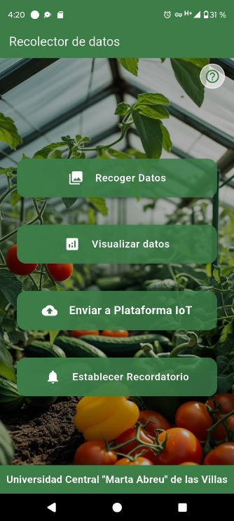
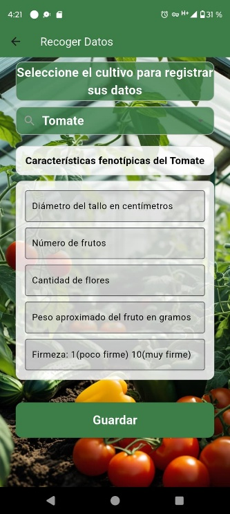
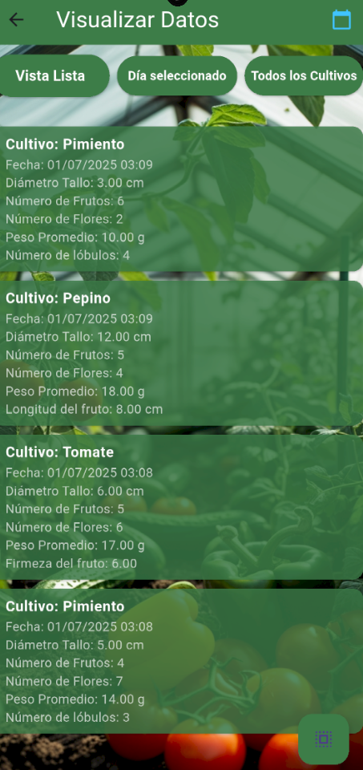
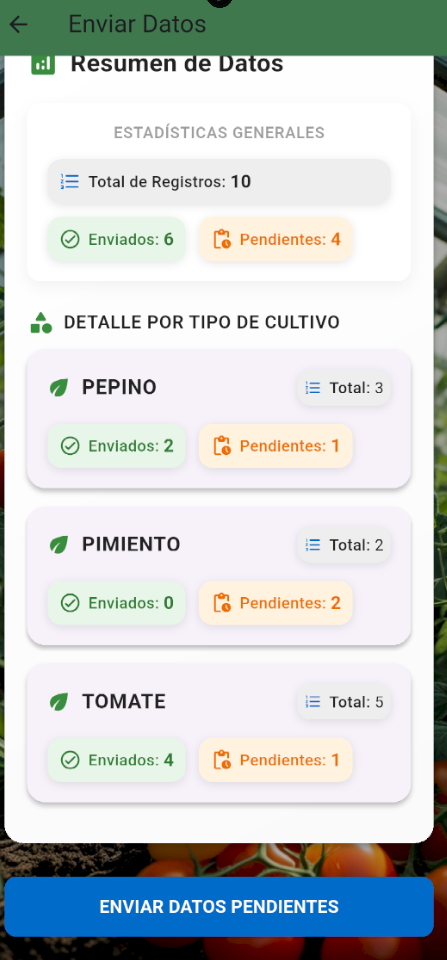
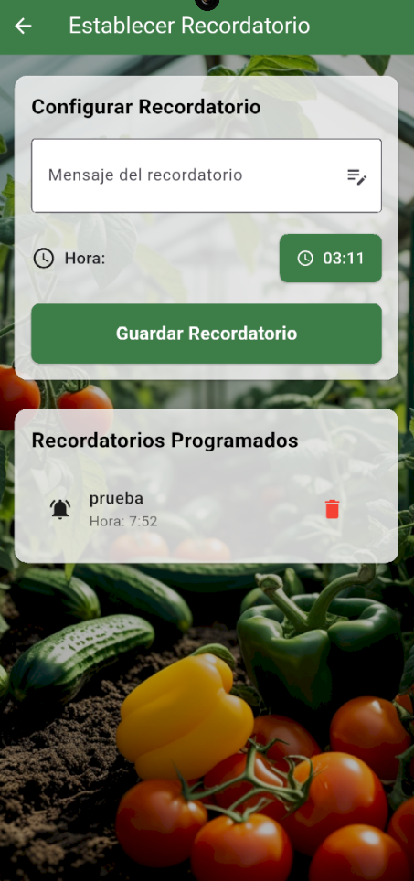

# Application workflow and screens

The thesis identifies **six primary screens**: home, first-use quick guide, data collection, data visualization, IoT submission, and reminders.

## 1. Home screen

A central navigation screen with four main actions: collect data, visualize data, send data to the IoT platform, and set reminders. A help action opens the quick guide.

## 2. First-run guide

On first use, the app shows simple orientation for the operator. On subsequent launches, it opens the main menu directly. An original screenshot of the guide was not distinctly available among the extracted figures.

## 3. Crop-specific data entry

The user selects tomato, cucumber, or bell pepper. Fields adapt to the selected crop; required values and types are validated. The app saves the observation to SQLite and associates a date with it.

## 4. Local data viewing and editing

Records can be inspected in a list/table-oriented interface, filtered by crop/date, and edited or deleted. The thesis also describes alternate data viewing modes and multi-record operations in later revisions.

## 5. ThingsBoard synchronization

The user can open the submission screen to view pending and submitted records by crop, initiate transmission, follow progress and messages, and access ThingsBoard views.

## 6. Local reminders

Time and reminder message can be configured, and the application displays scheduled reminders.

## Interface guidelines followed

The thesis describes responsive Flutter layouts with scrollable content, a visual hierarchy, background photographs with overlays, a consistent color palette, and accessible controls for users with limited technical experience.

**Thesis sources:** Sections 3.2.1 and 3.2.2 (printed pages 40–44); Figure 3.2 and Annexes 1–3.
