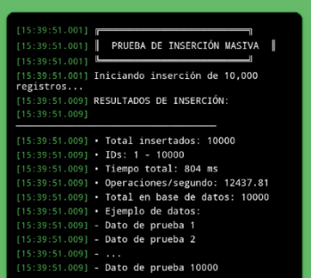
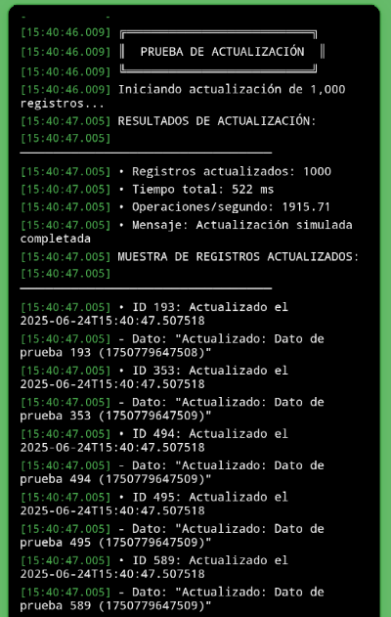
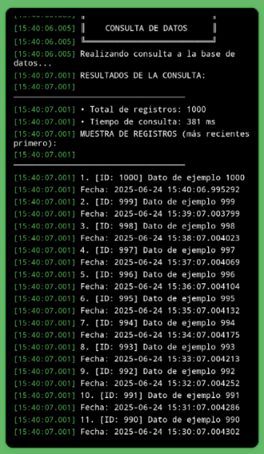
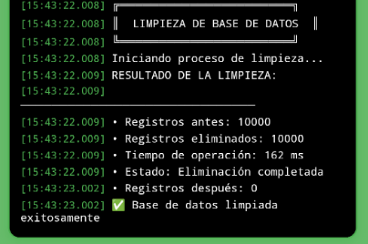

# Evaluation, tests and documented results

All reported measurements in this document are **transcribed from the 2025 thesis**; they have not been independently rerun for this repository. They describe the devices, environments and workloads used in the study.

## Android compatibility testing

The thesis reports an initial **Pixel 8 / Android 13 (API 33) emulator** and subsequent installation on four physical Android phones (Table 3.2).

| Physical device | Android version | RAM | Screen resolution |
| --- | --- | ---: | --- |
| Motorola G Play (2024) | Android 13 | 4 GB | 1600 × 720 |
| Samsung Galaxy A34 | Android 14 | 6 GB | 2340 × 1080 |
| Alcatel 1 SE | Android 11 Go Edition | 2 GB | 960 × 480 |
| Xiaomi Redmi A2 (2023) | Android 13 Go Edition | 2 GB | 1600 × 720 |

The author reports that all four tested devices supported local record storage and IoT communication without critical errors. This does not guarantee support for every Android phone.

[Device matrix CSV](../results/android-devices.csv)

## SQLite benchmark — thesis Table 3.4

These figures were obtained with a dedicated diagnostic build, not necessarily the same UI exposed to end users.

| Test | Workload | Total time | Additional recorded result |
| --- | --- | ---: | --- |
| Bulk insertion | 10,000 inserts | **804 ms** | 12,437.81 operations/s |
| Read query | 1,000 records retrieved | **381 ms** | first 1,000 records |
| Bulk update | 1,000 random records | **522 ms** | 1,915.71 operations/s |
| Cleanup | 10,000 records deleted | **162 ms** | all deleted |
| Database file | after test | — | approximately 819 KB |

[SQLite results CSV](../results/sqlite-benchmark.csv)

### Original test screenshots

| Bulk insertion | Update |
|:--:|:--:|
|  |  |

| Read | Cleanup |
|:--:|:--:|
|  |  |

## Reported per-record values — thesis Table 3.5

| Operation | Reported average elapsed time |
| --- | ---: |
| Insert | 0.0804 ms |
| Read | 0.381 ms |
| Update | 0.522 ms |
| Delete | 0.0162 ms |
| Synchronize | 1,057 ms |

The *local* per-record values in Table 3.5 are derived from bulk measurements, and **must not be read as independent per-operation benchmarks**. Remote synchronization time is orders of magnitude greater than local SQLite operations and runs as a deferred network activity.

## ThingsBoard HTTP connectivity

Section 3.4.1 describes (1) a single HTTP GET connectivity check to the demonstration server and (2) a sequence of **100 HTTP HEAD requests** to assess server availability and latency. It provides the following distribution for the 100 request timing measurements:

| Metric | Reported value |
| --- | ---: |
| Mean latency | **1,069.5 ms** |
| Median latency | **1,027 ms** |
| Standard deviation | **218.4 ms** |
| Minimum | **753 ms** |
| Maximum | **2,351 ms** |
| Approx. 80% of requests | **900–1,200 ms** |

The section later calls them “telemetry packets,” while the earlier test procedure explicitly says **HEAD** requests. To avoid overstating the method, this repository identifies them as **HTTP availability/response tests** and does not treat them as verified 100-record telemetry insertions. Table 3.5 separately reports 1,057 ms for an individual synchronization operation. The thesis conclusion mentions 100% success for a batch of up to 100, but the raw server logs and exact write-test procedure are not included here.

## User feedback

The thesis describes feedback from expert and non-expert users, including specialists from plant biotechnology, covering readability, navigation, record deletion/editing, and device compatibility. The sample size and a standardized survey instrument were not reported in the material reproduced here; **no quantitative user satisfaction score is claimed**.

## Notes on interpretation

- Workloads do not automatically represent realistic all-day farming usage.
- Benchmarks are not independently reproducible without the code, test suite and environment.
- Reported values are not a guarantee of platform performance on another server or network.
- The thesis does not present a new agricultural prediction model trained on these records.

**Thesis sources:** Section 3.3 (printed pages 47–50), Tables 3.2–3.5, Section 3.4 (51–57), Annexes 4–10, Conclusions (60).
